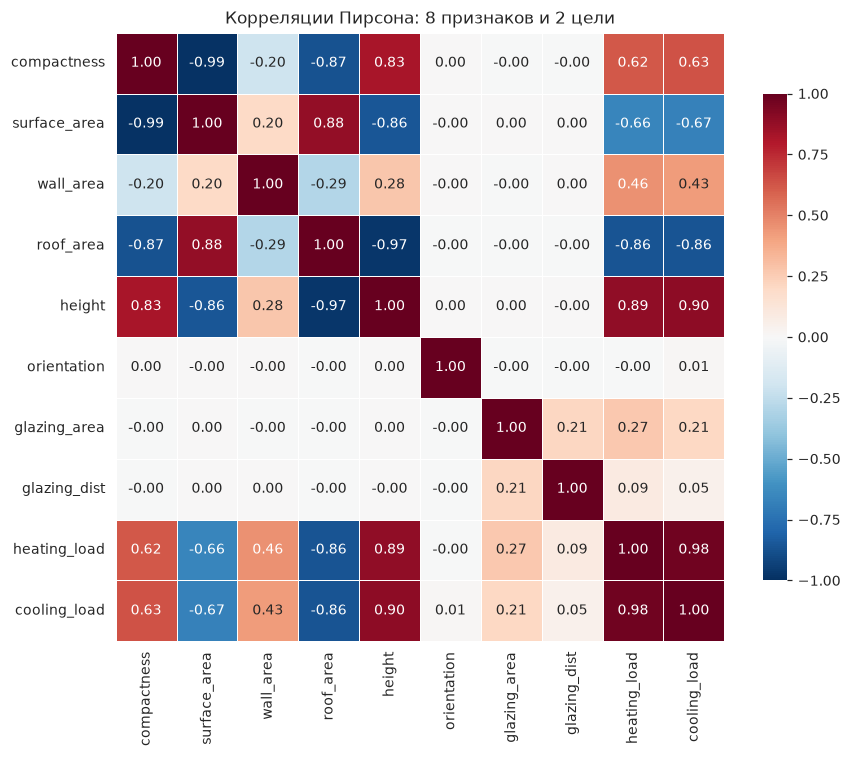
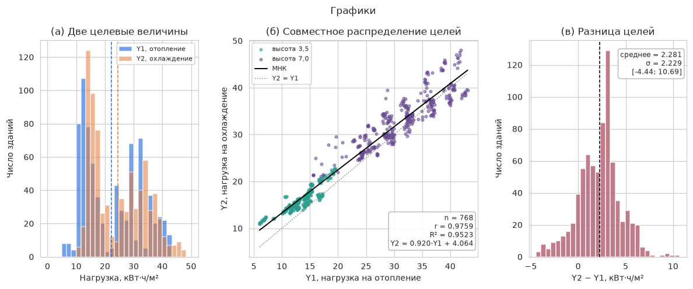

# Лабораторная работа 1. EDA: UCI Energy Efficiency (вариант 29, две цели)

## 1. Паспорт данных

| Параметр | Значение |
|---|---|
| Источник | UCI Machine Learning Repository, Energy Efficiency (https://archive.ics.uci.edu/dataset/242/energy+efficiency, DOI 10.24432/C51307) |
| Авторы | A. Tsanas, A. Xifara. *Energy and Buildings* 49 (2012), 560–567 |
| Лицензия | CC BY 4.0 (по странице датасета на UCI) |
| Файлы | `data/ENB2012_data.xlsx` (76 189 байт), `data/energy_efficiency.zip` (76 321 байт) |
| SHA-256 `ENB2012_data.xlsx` | `0089fcffc1415e41e2ff63730cca5280efe54fc43d722dfde1b0aaa808e35dc4` |
| SHA-256 `energy_efficiency.zip` | `499441eee27929a4b00417f58fd8c63c9cc14b8a71520cd0dd27fcb626738351` |
| Проверка | `sha256sum -c MANIFEST.sha256` и `verify(ROOT)`: оба файла совпали с манифестом (`all_match = True`) |
| Объём | 768 строк × 10 столбцов, 60,1 КБ в памяти |
| Задача | регрессия с двумя выходами: `Y1` (нагрузка на отопление) и `Y2` (нагрузка на охлаждение) |

### Поля

| Поле | Исходное | Смысл | Тип | Уник. | min | max |
|---|---|---|---|---|---|---|
| `compactness` | X1 | относительная компактность | float | 12 | 0,62 | 0,98 |
| `surface_area` | X2 | площадь поверхности, м² | float | 12 | 514,50 | 808,50 |
| `wall_area` | X3 | площадь стен, м² | float | 7 | 245,00 | 416,50 |
| `roof_area` | X4 | площадь крыши, м² | float | 4 | 110,25 | 220,50 |
| `height` | X5 | общая высота, м | float | 2 | 3,5 | 7,0 |
| `orientation` | X6 | ориентация (код) | int | 4 | 2 | 5 |
| `glazing_area` | X7 | доля остекления | float | 4 | 0,0 | 0,4 |
| `glazing_dist` | X8 | распределение остекления (код) | int | 6 | 0 | 5 |
| `heating_load` | Y1 | нагрузка на отопление, кВт·ч/м² | float | 587 | 6,01 | 43,10 |
| `cooling_load` | Y2 | нагрузка на охлаждение, кВт·ч/м² | float | 636 | 10,90 | 48,03 |

### План разбиения

Разбиение в ноутбуке пока не выполнялось, ниже план для следующих лабораторных. Он опирается на выводы EDA.

- **Единица разбиения — группа строк, а не отдельная строка.** Ориентация не влияет на нагрузку (η² = 0,0000 / 0,0006): первые четыре строки, различающиеся только ориентацией, имеют одинаковые `Y1 = 15,55` и `Y2 = 21,33`. При случайном разбиении такие почти дубликаты попадут и в train, и в test, и оценка завысится. Поэтому строки, отличающиеся только `orientation`, остаются в одной части.
- **Доли:** train 70 % / val 15 % / test 15 %, `random_state = 42`. Стратификация по форме здания (X1–X4): все 12 форм (по 64 строки каждая) должны быть представлены во всех частях.
- **Дополнительная проверка:** leave-shape-out, то есть GroupKFold по 12 формам. Высота однозначно определяется формой (форм с обеими высотами 0), так что этот тест заодно показывает, как модель экстраполирует на новую высоту и компактность.
- **Предобработка** (масштабирование, отбор признаков) обучается только на train. Из X2/X3/X4 для линейных моделей оставляем два признака (ранг 7 из 8).
- **Метрики:** MAE и RMSE отдельно по `Y1` и `Y2`.

## 2. Сводки EDA

### Качество данных

| Проверка | Результат |
|---|---|
| Пропуски | 0 во всех 10 столбцах |
| Полные дубликаты строк | 0 |
| Дубликаты по 8 признакам | 0 |
| Выбросы по правилу 1,5·IQR | 0 во всех столбцах |
| Нули | только `glazing_area` (48 строк, 6,25 %) и `glazing_dist` (те же 48 строк, все со значением 0): остекления нет физически |
| Уникальных форм (X1–X4) | 12, по 64 строки на форму |
| Высота | 3,5 → 384 строки, 7,0 → 384 строки; форм с обеими высотами: 0 |
| max \|X2 − (X3 + 2·X4)\| | 0,0 |
| Ранг стандартизованных признаков | 7 из 8 |
| Число обусловленности | 3,31·10¹⁵ (минимальное сингулярное число 1,61·10⁻¹⁴) |

### Описательные статистики

| | mean | std | min | median | max | skew |
|---|---|---|---|---|---|---|
| compactness | 0,76 | 0,11 | 0,62 | 0,75 | 0,98 | 0,50 |
| surface_area | 671,71 | 88,09 | 514,50 | 673,75 | 808,50 | −0,13 |
| wall_area | 318,50 | 43,63 | 245,00 | 318,50 | 416,50 | 0,53 |
| roof_area | 176,60 | 45,17 | 110,25 | 183,75 | 220,50 | −0,16 |
| height | 5,25 | 1,75 | 3,50 | 5,25 | 7,00 | 0,00 |
| orientation | 3,50 | 1,12 | 2,00 | 3,50 | 5,00 | 0,00 |
| glazing_area | 0,23 | 0,13 | 0,00 | 0,25 | 0,40 | −0,06 |
| glazing_dist | 2,81 | 1,55 | 0,00 | 3,00 | 5,00 | −0,09 |
| **heating_load** | 22,31 | 10,09 | 6,01 | 18,95 | 43,10 | 0,36 |
| **cooling_load** | 24,59 | 9,51 | 10,90 | 22,08 | 48,03 | 0,40 |

### Целевые величины

| | Y1 heating_load | Y2 cooling_load |
|---|---|---|
| Доля ≥ 30 кВт·ч/м² | 26,30 % | 33,20 % |
| Доля < 15 кВт·ч/м² | 37,11 % | 19,27 % |

- Связь целей: `r = 0,9759`, `R² = 0,9523`, p < 1e-300. МНК: `Y2 = 0,9201·Y1 + 4,0636`.
- Разница `Y2 − Y1`: среднее 2,281, σ 2,229, диапазон [−4,44; 10,69]. В 13,02 % строк `Y2 < Y1`.
- Обе цели ≥ 30 одновременно: 25,91 % строк.

### Корреляции

Коэффициенты Пирсона признаков с целями. Незначимы при p > 0,05: `orientation` (для обеих целей) и `glazing_dist` (для `Y2`):

| Признак | r с Y1 | r с Y2 |
|---|---|---|
| height | 0,889 | 0,896 |
| roof_area | −0,862 | −0,863 |
| surface_area | −0,658 | −0,673 |
| compactness | 0,622 | 0,634 |
| wall_area | 0,456 | 0,427 |
| glazing_area | 0,270 | 0,208 |
| glazing_dist | 0,087 (p = 0,015) | 0,051 (p = 0,162) |
| orientation | −0,003 (p = 0,943) | 0,014 (p = 0,693) |

Коллинеарность внутри признаков: `compactness` ~ `surface_area` r = −0,9919, `roof_area` ~ `height` r = −0,9725. Корреляция целей между собой: `r(Y1, Y2) = 0,9759`.

### Влияние групп (ANOVA, η²)

| Группировка | Уровней | η² Y1 | η² Y2 | p (Y1 / Y2) |
|---|---|---|---|---|
| Форма (X1–X4) | 12 | 0,9083 | 0,9217 | < 1e-300 |
| Высота (X5) | 2 | 0,7911 | 0,8024 | 1,14e-262 / 5,86e-272 |
| Площадь остекления (X7) | 4 | 0,0815 | 0,0449 | 5,09e-14 / 1,15e-07 |
| Распределение остекления (X8) | 6 | 0,0424 | 0,0180 | 3,69e-06 / 0,0166 |
| Ориентация (X6) | 4 | 0,0000 | 0,0006 | 0,999 / 0,926 |

## 3. График проблемы

Проблема варианта 29: две целевые величины, сильно связанные, но не совпадающие.

- (а) Обе цели имеют два горба. Средние: 22,31 (Y1) и 24,59 (Y2).
- (б) `r = 0,9759`, но точки не лежат на линии `Y2 = Y1`: МНК-прямая идёт выше и круче (наклон 0,920, свободный член 4,064). Нижний кластер — высота 3,5, верхний — высота 7,0.
- (в) Разница `Y2 − Y1` имеет среднее 2,281 при σ = 2,229 и меняет знак: `Y2 < Y1` в 13,02 % строк.

## 4. Выводы

1. Данные чистые: пропусков, дубликатов и выбросов по IQR **0**. Нули в `glazing_area` (**48** строк, 6,25 %) означают отсутствие остекления, их не нужно заполнять или удалять.
2. Выборка сбалансирована: **12** форм × **64** строки = 768. Высота принимает 2 значения по **384** строки, и каждая форма имеет только одну высоту, поэтому эффект высоты нельзя отделить от формы.
3. Признаки избыточны: `surface_area = wall_area + 2·roof_area` с ошибкой **0**, ранг матрицы признаков **7** из 8, число обусловленности **3,31·10¹⁵**. Для линейных моделей нужно убрать один из трёх признаков площади или использовать регуляризацию.
4. Цели нельзя заменить одной: при `r = 0,9759` средняя разница равна **2,281** (σ **2,229**, диапазон от **−4,44** до **10,69**), а в **13,02 %** строк охлаждение меньше отопления. Нужны два выхода и отдельные MAE/RMSE по каждой цели.
5. Нагрузка ≥ 30 кВт·ч/м² у **26,30 %** зданий по Y1 и **33,20 %** по Y2; обе цели ≥ 30 у **25,91 %**. Высокая нагрузка встречается регулярно, это не редкий класс.
6. Нагрузку определяет форма здания: **η² = 0,91** (Y1) и **0,92** (Y2). Высота даёт **0,79 / 0,80**, остекление **0,08 / 0,045**.
7. Ориентация не несёт сигнала: η² = **0,0000 / 0,0006**, ANOVA p = **0,999 / 0,926**. Её можно исключить из модели, а при разбиении строки с разной ориентацией нужно держать в одной части (см. план в п. 1).
8. Линейные связи с нагрузкой сильные только у габаритных признаков: `height` (r = **0,889** / **0,896**) и `roof_area` (r = **−0,862** / **−0,863**). Остекление слабое (`glazing_area` r = **0,270** / **0,208**), ориентация нулевая (r = **−0,003** / **0,014**). Признаки при этом сильно дублируют друг друга: `compactness` ~ `surface_area` r = **−0,9919**, `roof_area` ~ `height` r = **−0,9725**, поэтому коэффициенты линейной модели на них будут неустойчивы.
